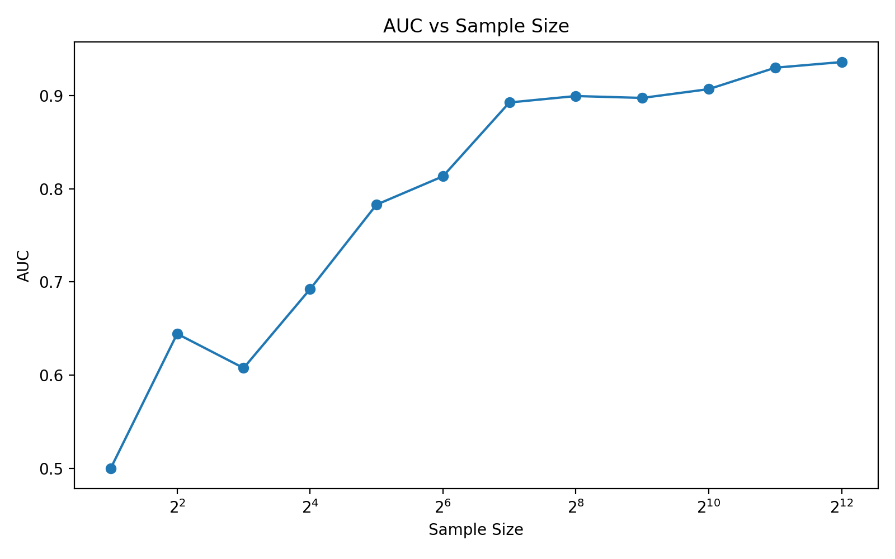
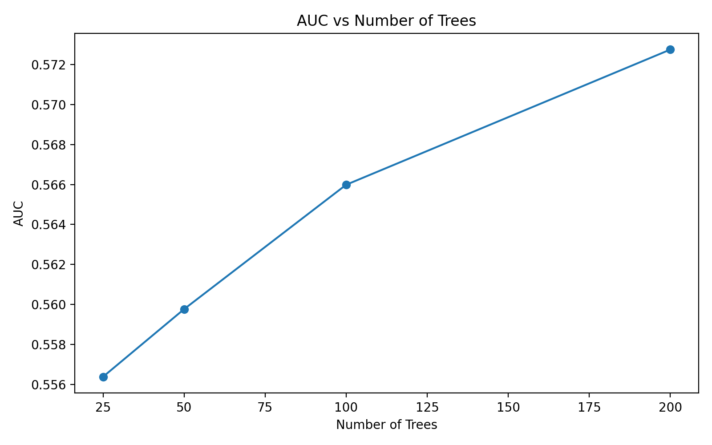
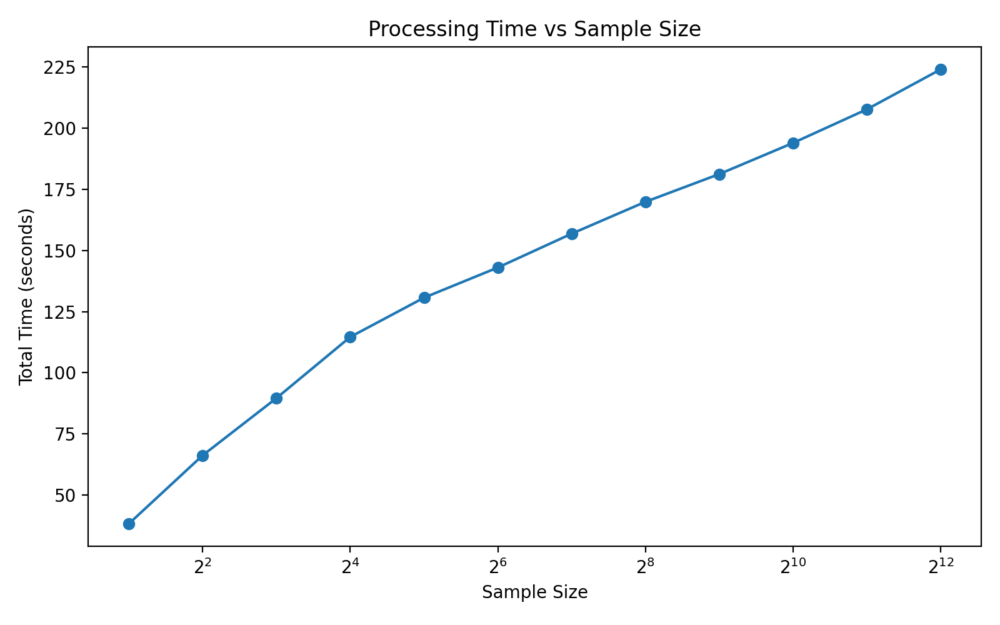
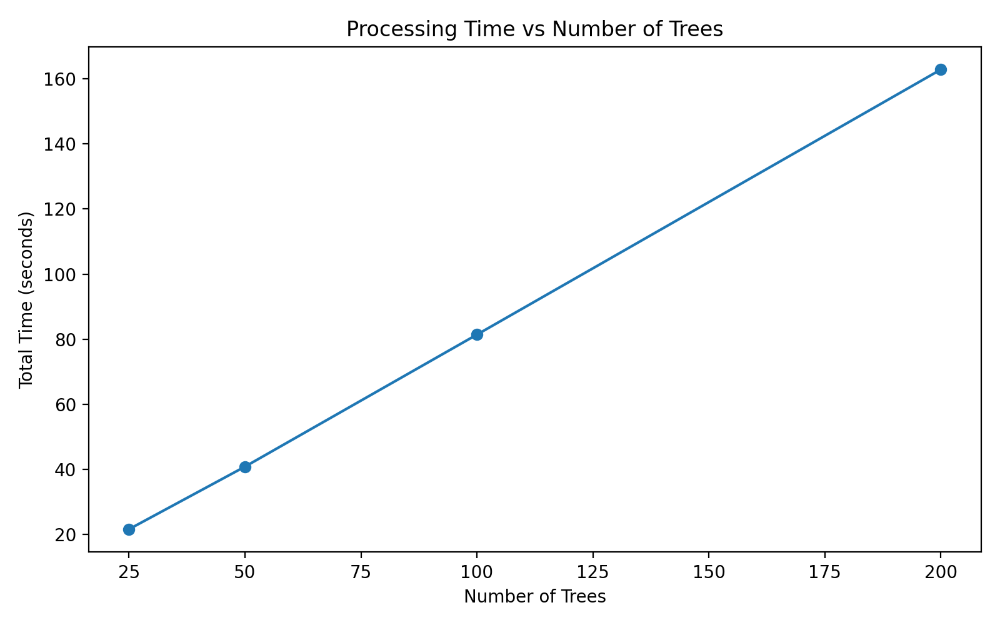
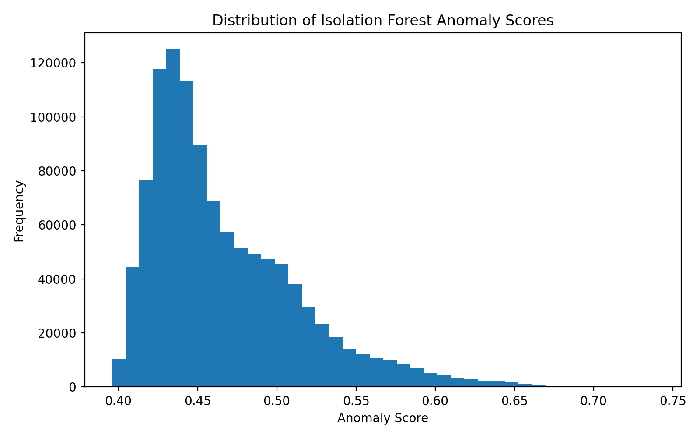
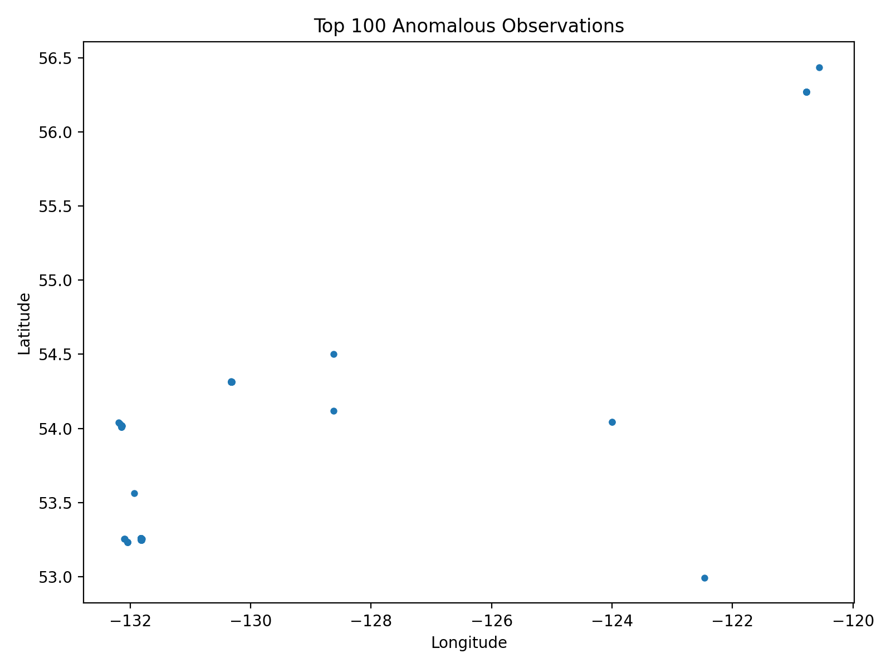
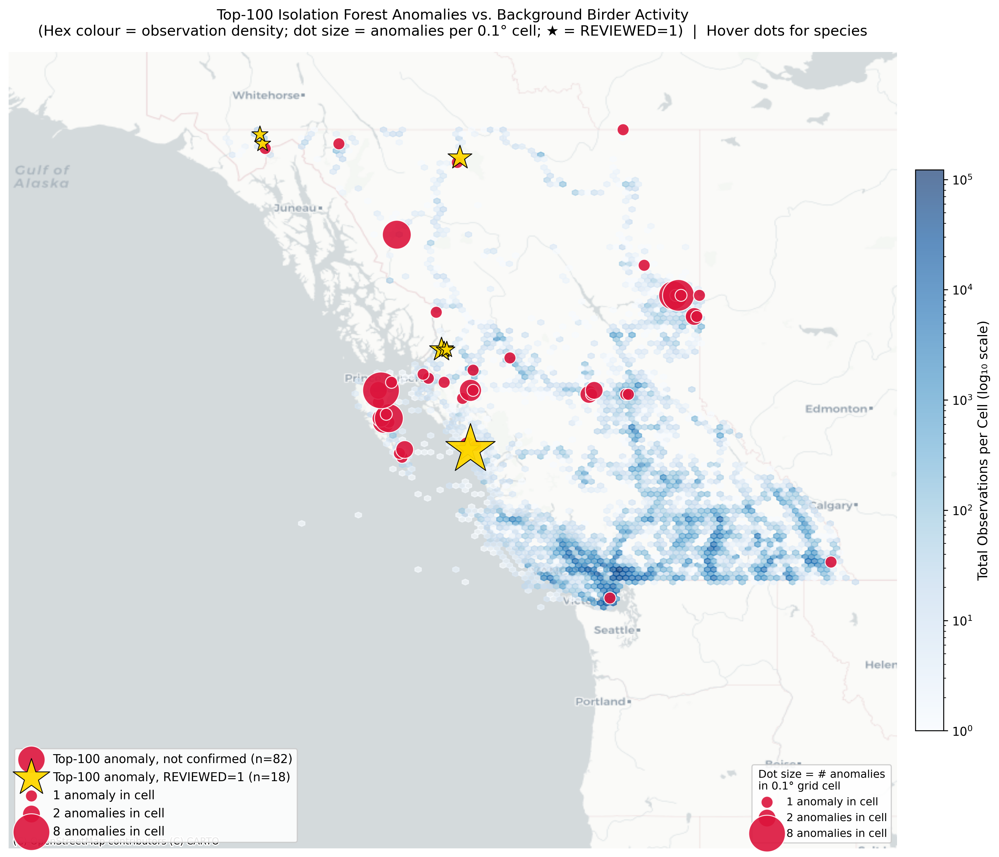
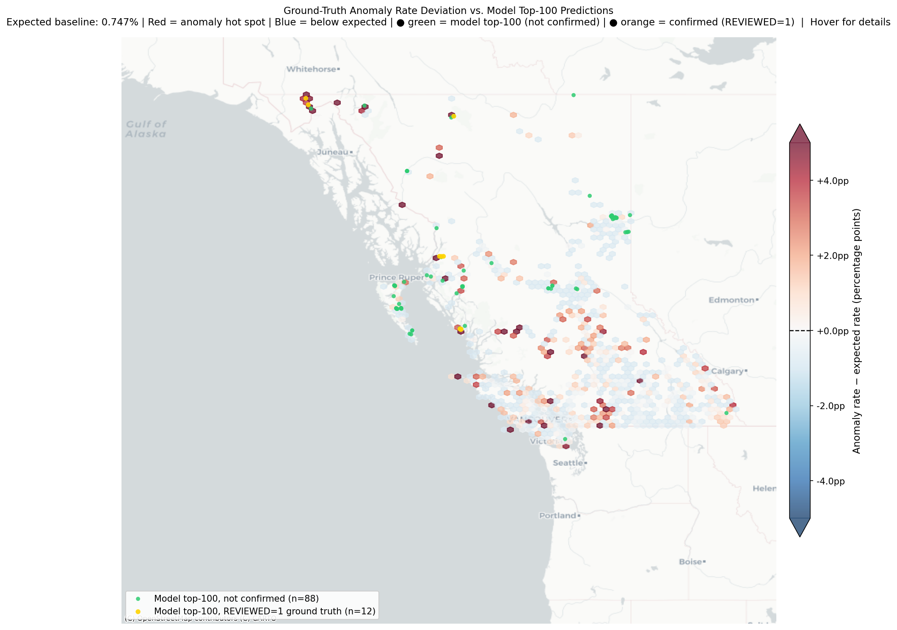

# Anomaly Detection at Scale on Species Data

[**Final Report (PDF)**](papers/Final%20Report.pdf) &nbsp;·&nbsp;
[**Final Presentation (PDF)**](papers/Final%20Presentation.pdf)

<details>
<summary><b>Contents</b></summary>

- [1. How to run](#1-how-to-run)
- [2. Dataset and Ground Truth Labels](#2-dataset-and-ground-truth-labels)
- [3. Data Preprocessing](#3-data-preprocessing)
- [4. Sampling](#4-sampling)
- [5. Implementation](#5-implementation)
- [6. Experimental Setup](#6-experimental-setup)
- [7. Evaluation Metrics](#7-evaluation-metrics)
- [8. Results](#8-results)

</details>

## 1. How to run

### Step 0: Confirm raw data exists

```
Make sure the 'ebird_data_raw.txt' file is in the 'data' folder
```

### Step 1: Process raw data

```bash
python scripts/process_data.py
```

This generates:

```
data/ebird_data_processed.csv
```

### Step 2: Sample processed data

```bash
python scripts/sample_processed_data.py
```

This generates:

```
data/ebird_data_processed_sampled.csv
```

### Step 3: Run Isolation Forest

```bash
python -m scripts.run_iforest
```

### Step 4: Run experiments

```bash
python -m scripts.run_experiments
```

---

## 2. Dataset and Ground Truth Labels

The processed dataset contains the following columns:

| Column            | Description                              |
| ----------------- | ---------------------------------------- |
| TAXON CONCEPT ID  | Species identifier                       |
| species_frequency | Relative frequency of species in dataset |
| OBSERVATION COUNT | Number of individuals observed           |
| LATITUDE          | Observation latitude                     |
| LONGITUDE         | Observation longitude                    |
| day_sin           | Cyclical encoding of day of year         |
| day_cos           | Cyclical encoding of day of year         |
| REVIEWED          | eBird review flag                        |

The `REVIEWED` column indicates whether an observation was flagged by the eBird review system for manual verification.

Observations may be flagged when:

* the species is unusual for the location
* the species is unusual for the time of year
* the observation count is unusually high

This field is used as a **ground-truth anomaly label for evaluation only**, and is **not used as a feature during model training**.

---

## 3. Data Preprocessing

The raw eBird dataset is processed using Apache Spark to produce a clean dataset suitable for Isolation Forest.

The preprocessing pipeline performs the following steps:

* keep only rows where `CATEGORY = species`
* remove provisional and escaped species observations
* keep only `Traveling` or `Stationary` observation types
* keep only complete checklists
* keep only observations with duration ≤ 300 minutes
* keep only observations with distance ≤ 10 km
* convert numeric columns to proper numeric types
* encode observation date using cyclic sine and cosine transformations
* compute species frequency as a numerical representation of species identity

The resulting processed dataset is exported as a single CSV file.

---

## 4. Sampling

After preprocessing, the dataset is still too large. To reduce computational cost, a sampling step is applied.

The sampling procedure performs the following steps:

* partition the dataset into groups based on quantiles of `species_frequency`
* perform uniform random sampling within each group
* use the same sampling fraction across all groups

This ensures that:

* the dataset size is reduced
* the relative representation of rare and common species is preserved
* the distribution of the data remains consistent for downstream experiments

The sampling fraction is controlled in the script:

```
sample_fraction = 0.05
```

---

## 5. Implementation

The Isolation Forest algorithm was implemented from scratch in Python.

The implementation includes the following modules:

| File                 | Purpose                                |
| -------------------- | -------------------------------------- |
| `itree.py`         | Isolation Tree construction            |
| `iforest.py`       | Isolation Forest ensemble              |
| `iforest_math.py`  | mathematical functions such as c(n)    |
| `data_utils.py`    | dataset loading and feature extraction |
| `run_pipeline.py`  | anomaly scoring pipeline               |
| `experiments.py`   | experiment automation                  |
| `visualization.py` | result visualization                   |

The model is trained using the feature columns:

* species_frequency
* observation count
* latitude
* longitude
* seasonal encoding features (day_sin, day_cos)

The `REVIEWED` column is excluded from training to prevent information leakage.

---

## 6. Experimental Setup

Experiments evaluate the effect of Isolation Forest hyperparameters on anomaly detection performance and computational efficiency.

The following parameters are varied:

### Number of Trees

```
25, 50, 100, 200
```

### Subsample Size (ψ)

```
2, 4, 8, 16, 32, 64, 128, 256, 512, 1024, 2048, 4096
```

---

## 7. Evaluation Metrics

The following metrics are measured:

### ROC AUC

ROC AUC evaluates how well anomaly scores separate reviewed observations from normal observations.

### Runtime Metrics

* training time
* scoring time
* total runtime

These metrics measure the scalability of the algorithm.

---

## 8. Results

The experimental results include:

### Detection Performance

* ROC AUC vs subsample size

  

* ROC AUC vs number of trees

  


### Computational Efficiency

* runtime vs subsample size

  

* runtime vs number of trees

  


### Anomaly Analysis

* histogram of anomaly scores

  

* geographic map of top anomalous observations

  

* ranked list of highest anomaly scores

  [`outputs/top_anomalies.csv`](outputs/top_anomalies.csv)

  

  

